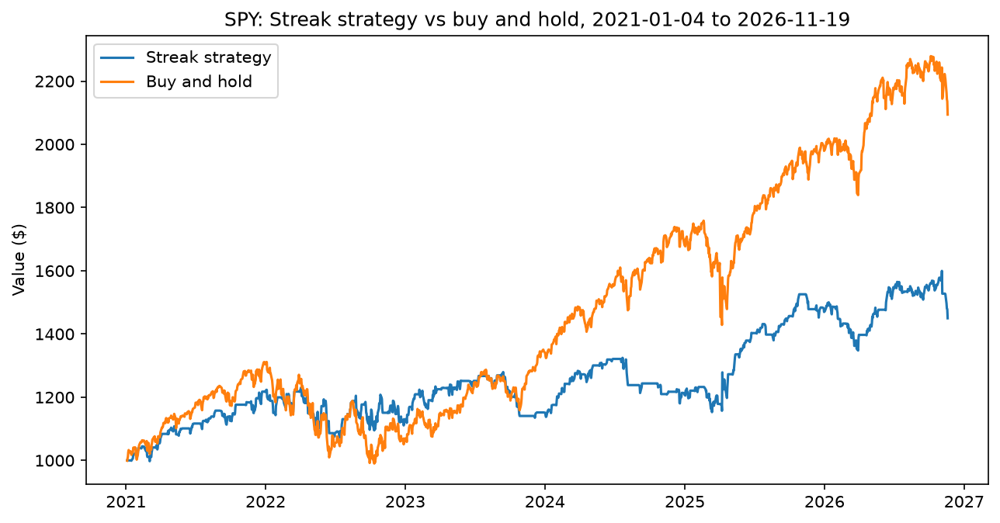

# sandpanalysis: S&P 500 data pipeline and backtest

[One or two sentences in your own words: what this project does and why you built it.]

## Origins

[Two or three sentences: you started Dionysus in Year 12 (2023) by scraping S&P 500 prices into Excel and testing whether losing streaks are followed by a rebound. Say what this version fixes.]

## What it does

1. **Fetches** daily SPY prices (an ETF that tracks the S&P 500) from the Tiingo API, with timeouts, retries and logging.
2. **Stores** them in SQLite, safely re-runnable, and queries them in SQL (`sql/queries.sql`).
3. **Checks** the data for ordering, duplicate, missing, non-positive, gap and outlier problems.
4. **Backtests** a streak strategy (buy after a run of down days, sell after a run of up days) with a stop-loss and trading costs.
5. **Tests it fairly:** thresholds come from 2014–2020 only, and the strategy is compared with buy-and-hold on 2021 onwards.

## Results

Test period: [start] to [end]

| | Streak strategy | Buy and hold |
|---|---|---|
| Total return | [ ] | [ ] |
| Annualised return | [ ] | [ ] |
| Maximum drawdown | [ ] | [ ] |
| Number of trades | [ ] | 1 |



[What you found, in two or three sentences.]

## Data checks

[What `find_problems` found on the real data, and what you did about it.]

## Assumptions

- Prices: adjusted close, because [your reason].
- Trades happen at the close of the day the signal appears.
- Costs: [x]% of the trade value on every buy and sell, because [your reason].
- Stop-loss: [x]% below the buy price.

## Limitations

[Your words. For example: one ticker, one test period, simple cost model.]

## Next steps

[ ]

## Run it yourself

```bash
python3 -m venv ~/.venvs/sandpanalysis
source ~/.venvs/sandpanalysis/bin/activate
pip install -r requirements.txt
cp .env.example .env        # add your free Tiingo API token
python run_fetch.py         # fetch, check and store prices
python run_backtest.py      # train/test backtest and chart
pytest                      # run the tests
```

## Project structure

The code lives in the `sandpa` package (short for sandpanalysis).

```
sandpa/
  config.py      settings: symbol, dates, costs, paths
  fetch.py       API requests, retries, parsing
  db.py          SQLite storage and queries
  clean.py       data quality checks
  strategy.py    returns, streaks, backtest, buy-and-hold
  metrics.py     total/annualised return, drawdown
run_fetch.py     pipeline: API → checks → database
run_backtest.py  train/test backtest and chart
tests/           tests for every module
```

## Data

Prices come from Tiingo's free plan, which is for internal use, so the raw data isn't included in this repository. Run `run_fetch.py` with your own token to download it.
